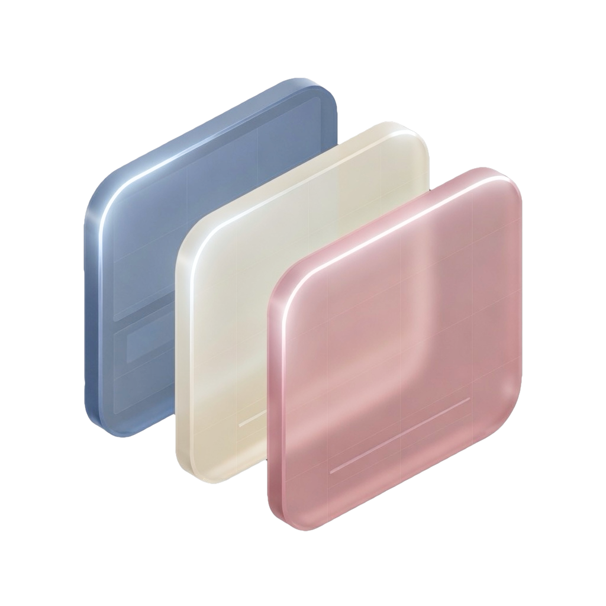
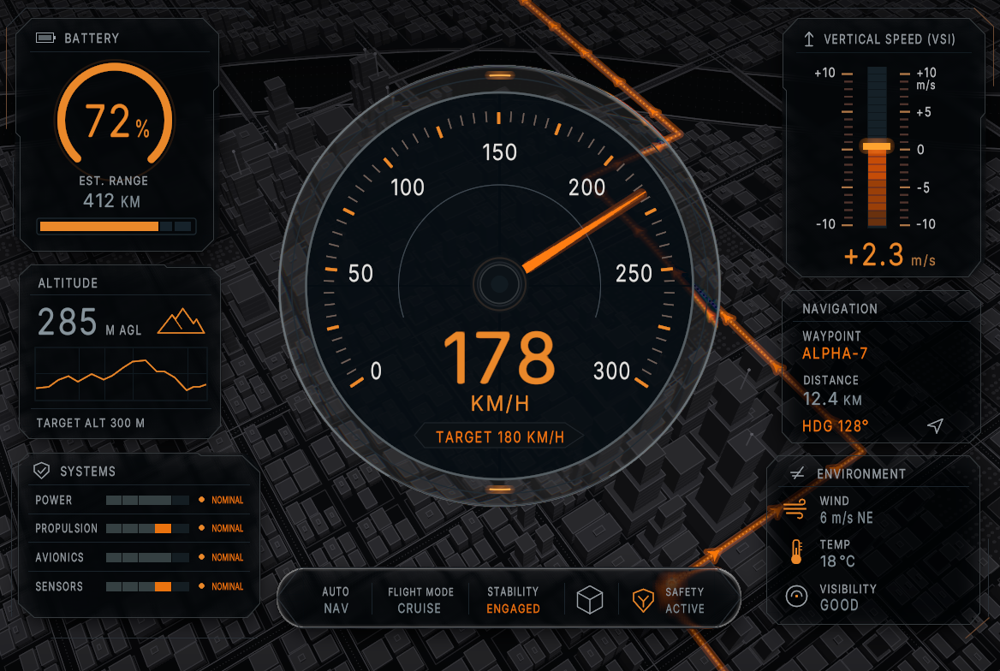
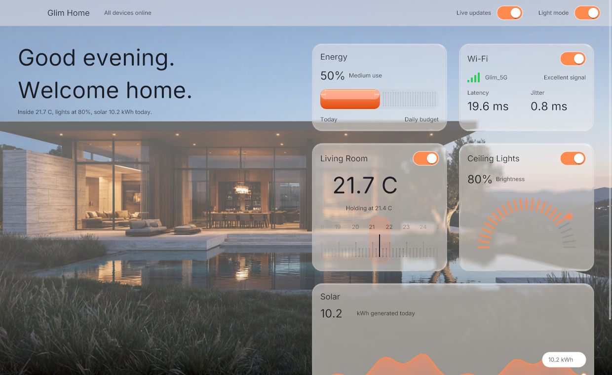
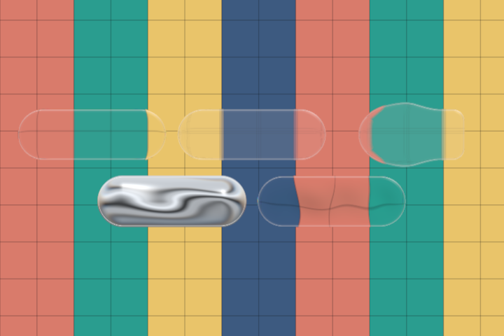

<p align="center">
  
</p>

<h1 align="center">Glim</h1>

<p align="center">
  A modular, GPU-first UI stack in C++, built for AI agents as much as for humans.
</p>

<p align="center">
  <a href="https://github.com/lykhonis/glim/actions/workflows/ci.yml"></a>
  
  
  <a href="LICENSE"></a>
</p>

## Why Glim

- **Layers you can swap.** Host, Graphics and Toolkit are separate packages. Use all three, replace one, or skip the toolkit and paint directly.
- **One scene graph.** The renderer, hit testing and accessibility walk the same tree. UI blocks, raw paint and native views mix in one frame.
- **Real materials.** Liquid glass, frosted backdrops, liquid metal, water, drop shadows, glow and blend modes run on every backend.
- **Same pixels everywhere.** Metal, Vulkan, WebGPU and a CPU rasterizer share one compositor, and golden tests pin the output.

## Built for agents and humans

An agent can build a Glim app, run it, see it, measure it and fix it without extra tooling. Every app ships the same headless interface:

- **See:** `--snapshot` renders a frame to PNG, so an agent can look at what it built.
- **Read:** `--dump-a11y` prints the UI as text, and `--dump-ops` saves the recorded op stream so two frames can be compared byte for byte.
- **Drive:** `--e2e` taps, presses keys, scrolls, steps time and asserts text, and `--probe` runs an interactive session over stdin.
- **Measure:** `--stats`, `--trace-frames` with a Chrome trace, `--soak` for op growth and `--drive` for live input latency.

Humans get the same loop: these flags are the profiler, the test runner and the screenshot tool, and they run in CI as plain tests.

## Examples

| | |
| --- | --- |
|  | **[Infotainment](examples/infotainment)**: a flying-EV cockpit. Glass gauges, glow and a live 3D city map under frosted cards. `pnpm exec nx run infotainment:run` |
|  | **[Smart home](examples/smarthome)**: a glass dashboard over a photo backdrop, with animated switches, charts, gauges and light/dark themes. `pnpm exec nx run smarthome:run` |
|  | **[Glass](examples/glass)**: the lens materials side by side. Clear and frosted glass, merging pills, liquid metal and water. `pnpm exec nx run glass:run` |

## A taste of the toolkit

Effects are tags on any block. Custom elements paint the same effects through their sink, and both mix in one tree.

```cpp
#include <glim/toolkit.h>
#include <glim/toolkit/host/Host.h>

using namespace glim::toolkit;

Block card() {
  return column(
      glass(16),
      shadow(16.f, 0.f, 8.f),
      effectGlow(0xff7a3dffu, 0.6f, 12),
      pad(20),
      lines("Glass, shadow and glow are tags.")
  );
}

int main() {
  return host::run({.title = "Hello Glim", .width = 480, .height = 320}, [](const Engine&) {
    return column(pad(32), gap(16), lines("Hello, Glim"), card());
  });
}
```

## Architecture

```
 Toolkit   glim-toolkit, glim-toolkit-host   blocks, state, layout, animation, a11y
    │
 Graphics  glim-paint, glim-gpu-*            scene, merge, isolate, glass, CPU raster
    │
 Host      glim-shell-*, glim-embed          window, vsync, input, native views
```

| Platform | Shell | GPU |
| --- | --- | --- |
| macOS, iOS, tvOS | AppKit, UIKit | Metal |
| Android (phone, TV, AAOS) | NativeActivity | Vulkan |
| Linux | Wayland | Vulkan |
| Web | Emscripten | WebGPU |
| Anywhere | any | CPU rasterizer |

Glim also embeds. A sandboxed guest, such as WASM or an out-of-process UI, encodes one frame packet per vsync, and the native host submits it while keeping its own swapchain and run loop.

## Try it

```sh
pnpm install
pnpm test
pnpm exec nx run smarthome:run
```

Every app takes the same headless flags:

```sh
glim-smarthome --snapshot out.png                            # see a frame
glim-smarthome --dump-a11y                                   # read the UI as text
glim-smarthome --e2e "~Glim Home;tap:i:5;step:0.5"           # drive and assert
glim-smarthome --trace-frames 20 --trace-json trace.json     # profile in Perfetto
glim-smarthome --soak 20 --stats                             # check for op growth
glim-smarthome --drive examples/smarthome/drive/controls.drive   # live latency report
```

## Building

Prerequisites: Node 24, pnpm 9.15 (`pnpm install`), CMake 3.22+ and Ninja.

- **Apple:** Xcode with the Metal toolchain (`xcodebuild -downloadComponent MetalToolchain` if `xcrun metal` is missing).
- **Android:** Android SDK and NDK (`android-*` presets).
- **Web:** Emscripten (`web-webgpu-debug` preset; wipe `build/` after upgrading it) and Chrome.
- **Linux:** `ninja-build pkg-config libwayland-dev wayland-protocols libvulkan-dev zlib1g-dev glslang-tools`.
- **Coverage:** gcovr; `pnpm coverage` fails below the floors in `tools/coverage-baseline.json`.

## Using Glim from CMake

Install a configured preset, then find it from your project. The GPU and shell backends are fixed by the preset you installed.

```sh
cmake --build build/macos-metal-release
cmake --install build/macos-metal-release --prefix ~/glim
```

```cmake
find_package(glim 0.1 REQUIRED COMPONENTS toolkit-host)
target_link_libraries(app PRIVATE glim::toolkit-host)
```

Components are `core`, `image`, `gpu`, `paint`, `paint-cpu`, `paint-gpu`, `embed`, `toolkit`, `toolkit-host`, `toolkit-host-cpu`, `shell`, the installed `gpu-*` backend, and `glim` (everything). `tests/package` is a working sample; `pnpm package-test` installs and builds it.

## Contributions

Glim is maintained as a closed-contribution project. Pull requests are not accepted and will be closed without review. Bug reports and questions are welcome as issues, though a response is not guaranteed.

[MIT](LICENSE) · [Volodymyr Lykhonis](https://lykhonis.com)
